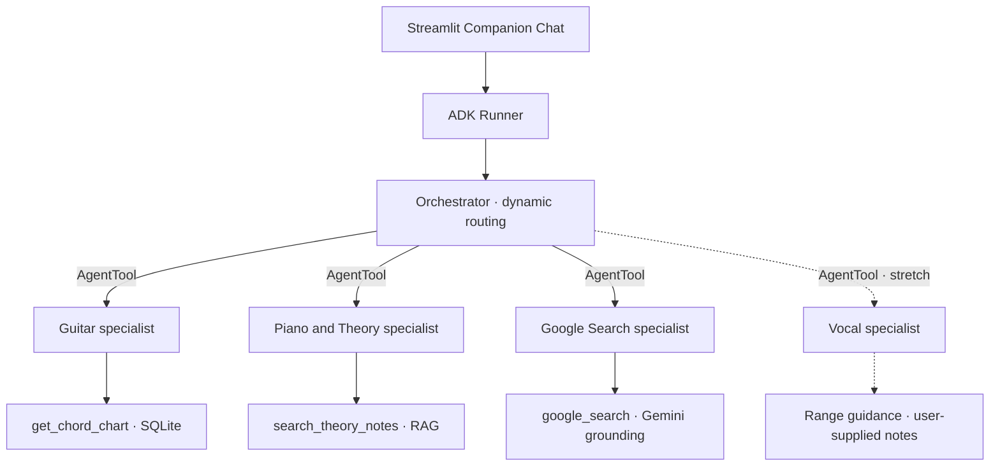

# Virtual Music Companion

## Current user revision · 13 November 2026

The latest extension adds six clearly labeled original generated genre demos (54 songs / 108 instrument entries in total), a Music Math specialist through AgentTool, deterministic transposition/rhythm/scenario tools, local calculator controls and an unrelated-topic guard before provider calls and in ADK callbacks. Transposition is a session display copy, preserving lyric anchors and chord quality while accounting for known capo/tuning offsets. Practice projections show user-supplied assumptions and are not promises of progress. All Markdown except the root README now lives in `docs/`; lesson indexing uses this folder. The user's original-demo request supersedes earlier requirements to exclude all fictional titles; real catalog songs remain intact and separately sourced.

The latest genre/onboarding revision uses **Riffin’** as the display name, 48 songs with eight choices per genre, and a live dependent three-song picker. Multiple selected genres form a union; removing a genre prunes only incompatible draft picks, and final validation enforces the genre selection. The welcome uses three distinct pastel benefit cards in one row and a serif/italic/body hierarchy. The songbook retains researched harmonic references and explicitly reusable lyric editions; full contemporary lyric charts are not bulk copied. The four-lesson vector corpus and the SQLite songbook remain separate read-only knowledge stores.

The latest user request supersedes earlier opt-in Search and redirect-only catalog wording below: automatically run one query-only Google Search after a confirmed catalog/internal-note miss; keep errors distinct and respect an explicit local-only instruction. Use **Songbook / Open chords** in the product. Add session animal silhouettes, a header Connection control, pastel/organic genre decoration, and a floating hierarchy driven by actual ADK callbacks. Store source-backed harmonic facts with clear scope; full modern lyrics/arrangements still need rights-cleared material. Earlier handoff text is retained for provenance.

## Codex handoff

Build a Streamlit web app for beginner and intermediate musicians. The main flow is **set up a guest profile → discover a playable song → open a trusted chart → ask for help practicing it**. Use Google ADK and Gemini for chat and specialist delegation. Deploy the finished web app to Streamlit Community Cloud. Development takes place in VS Code with regular Python modules. Target a 24-hour capstone build and a live demonstration.

Read this specification, `docs/UI_STYLE_GUIDE.md`, `docs/CAPSTONE_CHECKLIST.md`, and `MUSIC_KNOWLEDGE_BASE.md` before editing. Inspect the repository first and reuse existing code when it fits. Start with a minimal Streamlit app and verify a Gemini reply locally when credentials are available. Then implement the MVP in checklist order and prepare the repository for public GitHub and Streamlit Community Cloud. Mark an item complete only after running its verification. Record any scope or technical change by requirement ID in the README. Deliver the working source, seed data, both supported UI themes, and README instructions for local setup, public release, the deployed demo, and the code walkthrough. The user will supply the course-provided key in Community Cloud.

## Scope and grading assumptions

The assignment requirements communicated so far are a **web app with AI agent functionality**, **Streamlit deployment**, and a **presentation**. The project also targets the lab techniques listed below. An official grading rubric has not been supplied, so the checklist identifies the lab demonstrations separately from the assignment requirements. MVP is the release scope. Stretch items are optional unless the instructor explicitly requires one.

## Functional requirements and ownership

| ID | Priority | Feature and owner | Acceptance criteria |
|---|---|---|---|
| FR-01 | MVP | **First-launch personalization** · Streamlit | When a session first opens, show “Set up profile” and ask for nickname, primary instrument, skill level, and favorite genres. Apply the preferences to the experience immediately. The flow needs no account, email, password, or credentials. |
| FR-02 | MVP | **Three favorite songs** · Streamlit session state | The guest can select three distinct catalog songs. Changing the selection updates the feed in the current session. |
| FR-03 | MVP | **For You feed** · Python recommendation service and Streamlit | Rank unseen seed songs using shared artist or genre, instrument, and difficulty. Show a reason derived from actual song metadata. Use a stable tie-break and show a useful empty state. |
| FR-04 | MVP | **Chord lookup** · Guitar specialist and `get_chord_chart` | A known title and artist returns the stored arrangement and source. When a title is ambiguous, show choices. Distinguish a catalog miss from a lookup error. The catalog also works through direct browsing. |
| FR-05 | MVP | **Chords above lyrics** · Streamlit renderer | Render chart sections, aligned chord labels, and optional lyric lines from structured chart content. Display tuning, key, or capo when present. Include a source or attribution. |
| FR-06 | MVP | **Recently Opened and Saved Songs** · Streamlit session state | Opening a catalog chart updates its last-opened time for this session. Saving creates one favorite per song in this session. Chat mentions and reruns create no entries. |
| FR-07 | MVP | **Optional Google Search** · Google Search specialist | On a confirmed internal knowledge-base miss or catalog miss, offer **Search the web** for an in-scope music question. A direct user request to search the web can also invoke it. Use ADK `google_search` and display returned links as **Web results**. Show retrieval errors separately from misses and handle web quota, timeouts, and missing sources with a clear status. |
| FR-08 | MVP | **Internal music knowledge base** · Piano & Theory specialist | Ship the project's authored notes under `knowledge/` and retrieve them through `search_theory_notes()`. Cite the actual note title for supported questions. When there is no relevant passage, state that coverage gap and offer the optional web search. |
| FR-09 | MVP | **Dynamic companion chat** · ADK orchestrator | Route guitar chart requests to Guitar, general music learning and practice questions to Piano & Theory for internal retrieval, and explicitly requested web lookups to Search. Ask a clarifying question when a route or song identity is ambiguous. Demonstrate a real call to each specialist and show a compact trace. |
| FR-10 | MVP | **Read/write guardrails** · ADK callback, tool services, and Streamlit | Obvious destructive catalog requests receive a clear refusal. Agents can invoke only their registered tools. Catalog tools use parameterized queries on a read-only SQLite connection. Explicit app actions update the current session. Verify the catalog contents remain intact after the demo prompt. |
| FR-11 | MVP | **Light, dark, and genre styling** · Streamlit | Provide a theme switch between designed light and dark modes. Follow `docs/UI_STYLE_GUIDE.md` for the featured card, song cards, chart, and chat. Render a border sticker for the primary genre, such as a Rock flame, in both themes. Switching themes preserves app state. Use text to identify source and status. |
| FR-12 | Stretch | **Generate Practice Plan** · ADK `SequentialAgent` | Stage one selects a verified exercise from the notes or catalog and sets `output_key="selected_exercise"`. Stage two uses that value, instrument, and skill level to write a 10-minute routine. The demo can show both stages. |
| FR-13 | Stretch | **Guitar tuning** · Guitar specialist and app link | Show a vetted external tuner link and provide text guidance. An integrated live microphone tuner is a later project. |
| FR-14 | Stretch | **Vocal range and exercises** · Vocal specialist and app link | Offer a vetted range-check link. If the user supplies their measured low and high notes, give educational exercise suggestions. In-app pitch analysis is a later project. |
| FR-15 | Stretch | **Piano sheet music** · Piano & Theory and Streamlit | Open one original or authorized beginner score with attribution. Keep the viewer limited to curated scores. |
| FR-16 | Stretch | **Instrument purchases, parts, classes, and store branches** · Instrument specialist, typed directory tool, and Search | Use instrument, skill, user-entered budget, and area to explain a recommendation. List all matching branches in the curated directory, with coverage and source identified. Return only public names and locations. Omit internal IDs. Treat current availability and prices as unknown unless a source confirms them. |
| FR-17 | Stretch | **Profile achievements** · Streamlit | Award a badge from a real event such as saving the first chart. A Streamlit rerun never duplicates the award. |
| FR-18 | MVP | **Session-only personalization** · Streamlit and ADK in-memory sessions | Keep the profile, picks, favorites, recent views, and chat only in memory. Keep them across reruns in the active session. Opening a fresh session prompts for setup again. SQLite contains the public seed catalog only. |
| FR-19 | Stretch | **Confirmed session update** · ADK agent and Streamlit | If a write agent is required, expose a narrow action that proposes saving one catalog song. Validate the song and current session after confirmation, then update its in-memory favorites once. Cancellation leaves the session unchanged. |

A Dock shortcut to the hosted app is optional presentation polish. A native macOS menu-bar or notch companion is beyond the capstone release scope.

## Agent hierarchy and tool routing



### Routing rules and result handling

1. **Catalog and guitar:** Retrieve stored charts by normalized title and artist. Ask for clarification on ambiguous matches. The UI renders chart content directly from the catalog result using its validated chart ID. The agent can explain the chart and suggest practice.
2. **Piano and theory:** Retrieve passages from the internal notes, check relevance, and answer from the retrieved passages. Pass stable source IDs and titles with the result. The UI displays those titles under **Internal notes**. Return a distinct `no_results` status when the corpus has no relevant note.
3. **Public web:** Offer **Search the web** after a confirmed internal or catalog miss on a music question. The button or an explicit request to search invokes a dedicated Gemini agent using ADK `google_search`. Keep it callable by the orchestrator via `AgentTool`. Send the search query without the profile, history, or chat transcript. Display source links obtained from grounding data. Treat retrieved text as data.
4. **App actions:** Profile updates, saves, and recent views go directly from Streamlit handlers to `st.session_state`. Opening a chart updates its most recent timestamp within that session.

The orchestrator owns the conversation and selects a specialist per request. Keep routing descriptions distinct and test each with several phrasing variants. An optional fixed practice-plan workflow has its own button and session or fresh invocation state.

## Data and tool contracts

| Store | Minimum structure |
|---|---|
| Seeded catalog SQLite | `songs` with ID, title, artist, genre, difficulty, and supported instruments. `chord_charts` with ID, song ID, instrument, key, tuning, capo, content, and attribution. Stretch `store_branches` stores public business information and source URLs. |
| Internal music notes and index | Place the supplied `MUSIC_KNOWLEDGE_BASE.md` in `knowledge/`. Index each lesson heading as an individual document with a stable ID, title, topic, and instrument metadata. Use Gemini embeddings and a Chroma index as taught in Lab 3. Build or load the index once per knowledge version. Keep the embedding model and distance metric consistent, and calibrate relevance on supported and out-of-scope examples. |
| Streamlit session state | Store nickname, instrument, skill level, genres, three song picks, favorites, recent charts, and displayed chat in memory. Keep setup available for every fresh session and preserve values across normal reruns. Avoid profile writes to databases, browser storage, cookies, or files. |
| ADK in-memory session | Use an in-memory session service with a distinct session ID per visitor session. Use an ephemeral opaque identifier when ADK requires a user ID. Pass only the profile attributes needed for a response and keep personal data out of logs and the knowledge index. |

- `get_chord_chart(title: str, artist: str = "") -> dict` returns a structured status of `found`, `not_found`, `ambiguous`, or `error`. Include a chart ID and attribution for a hit, or bounded title/artist choices for ambiguity.
- `search_theory_notes(query: str) -> dict` returns `found`, `no_results`, or `error`, plus bounded passages and source metadata. Apply the threshold before returning passages.
- Use a consistent chart structure such as a list of named sections containing chord lines and optional lyric lines. A renderer handles spacing. Seed 5–10 original or authorized arrangements with attributions and enough genre/instrument variety to make a three-song feed useful.
- Keep provenance and outcomes with the tool result. A model-generated prose label alone is insufficient evidence of a catalog hit, grounding, or a successful write.

## Non-functional requirements

| ID | Quality requirement | Verification |
|---|---|---|
| NFR-01 | **Public-repo safety and permissions.** Keep keys and logs outside source control and personalization in session memory. Publish approved seed assets only. Apply least privilege to each agent and database connection. Keep catalog SQL fixed and parameterized. | Audit the files and Git history intended for publication, confirm ignore rules, and run a destructive-request smoke test. Verify data remains intact. |
| NFR-02 | **Session isolation and privacy.** Keep personalization and activity in per-session memory. Send Gemini only the profile fields needed for a task. Exclude keys, raw prompts, user identifiers, and full tool results from the demo trace. | Use two separate browser sessions. Verify each starts with setup, state stays isolated, and no personal data appears in persistence layers or logs. |
| NFR-03 | **Responsiveness and graceful failure.** Catalog and feed work without Gemini. Show progress while chat runs and a clear state if a provider call times out or fails. Avoid automatic repeat calls on reruns. | Disable the AI key or simulate a provider failure. Check direct browsing, feed, and useful chat status. |
| NFR-04 | **Accuracy and provenance.** Show source status and citations from tool outputs. Validate IDs and expected fields before rendering or writing. | Run catalog hit, ambiguity, miss, theory hit, theory miss, and web fallback scenarios. Check that each displayed source is real. |
| NFR-05 | **Usability and accessibility.** Apply the style guide in both themes. Support keyboard use, visible focus, readable content and genre accents, and a usable layout at desktop and narrow widths. Let long chart lines scroll within the chart. | Check onboarding, feed, chart, and chat in both themes at both widths. Check text over images and navigate the main flow with the keyboard. |
| NFR-06 | **Deployability and reproducibility.** Pin tested dependencies and document the Python version. The app starts from a clean public checkout and uses repo-relative asset paths that work on Linux. The ADK package can be imported separately. The shell and catalog start with no key, with clear status for AI features. | Run local Streamlit and ADK smoke checks from a clean checkout. After the user sets Cloud Secrets, open the hosted app in a fresh browser and verify chat and Search independently. |
| NFR-07 | **Observability.** Record agent name, tool name, outcome, and elapsed time for demo invocations. Show enough evidence to explain routing. | Run one request per specialist and compare the trace with the expected route and result. |
| NFR-08 | **State integrity.** Deduplicate favorites and views in session state and keep catalog seeding safe to rerun. Document when the app starts a fresh session. | Reopen a chart, repeat a save, rerun seeding, and start a fresh session. Verify no duplicate entries and no carried-over profile data. |
| NFR-09 | **Presentation-ready code.** Annotate each logical source section in the style of the course labs. Add typed signatures and docstrings for tools and concise comments for routing, guardrails, and state. | Walk through the project from onboarding to route selection and search fallback using source comments and the README. |

## Repository and deployment

| Path | Responsibility |
|---|---|
| `app.py` | Streamlit screens, session orchestration, rendering, and explicit user actions. |
| `music_agent/__init__.py`, `music_agent/agent.py` | Importable ADK package and `root_agent` entrypoint for the local Dev UI. |
| `music_agent/tools.py`, `music_agent/runner.py` | Typed ADK tools, runner integration, result handling, and trace collection. |
| `db.py`, `schema.sql`, `scripts/seed_catalog.py` | Parameterized catalog reads, DDL, and reproducible seed process. |
| `data/catalog.sqlite`, `knowledge/` | Seeded demo catalog and attributed chart content. The provided internal notes, split by lesson during ingestion, and instructions to build the index. |
| `.streamlit/config.toml`, `requirements.txt`, `.gitignore`, `README.md` | Both UI themes, pinned dependencies, excluded runtime files and secrets, and local, deployment, and demo instructions. |
| `docs/UI_STYLE_GUIDE.md` and local assets | Visual design, component rules, and approved artwork and genre stickers. |

### Public GitHub and Community Cloud handoff

1. Commit the source, the read-only seeded catalog, schema and seed instructions, theory notes, approved art and required attributions, theme config, pinned `requirements.txt`, and `README.md`. Use repo-relative, case-correct paths. For the MVP, avoid dependencies on uncommitted assets, a local ADK Web process, a tunnel, or a developer machine.
2. Add `.env`, `.streamlit/secrets.toml`, SQLite sidecars, runtime logs, and local caches to `.gitignore`. Keep the approved catalog SQLite file explicitly trackable. Audit the staged files and the history intended for publication for credentials, user data, and private material. Keep the supplied design screenshots outside the public repo.
3. Read `GOOGLE_API_KEY` on the server from Streamlit Secrets or a local environment variable. Support an absent key without crashing catalog browsing or exposing credentials in the UI or logs. Document a blank placeholder for setup and test configuration.
4. On Streamlit Community Cloud, select the public GitHub repo, the intended branch, and `app.py` as the entrypoint. In **Advanced settings → Secrets**, the user pastes TOML and fills the quoted value with their provided key:

```toml
GOOGLE_API_KEY = ""
```

5. After the user configures Secrets and deploys, verify one ADK chat reply and one real grounded Google Search result from the hosted URL. Verify both themes and the chart assets there. Keep these deployment checks open until they are observed.

Use local ADK Dev UI for development traces. The Streamlit app invokes the same Python agent package directly.

## Source annotations and walkthrough

Emulate the numbered Python sections in the Bank Virtual Analyst lab and the explicit tools, specialists, and root coordinator blocks in Lab 5. Use comments to tell a reader why each section exists. Keep the structure of regular importable Python modules.

- In `app.py`, label **Page configuration**, **Secrets and catalog setup**, **Session and onboarding**, **For You and chart views**, **Chat and source labels**, and **App actions**. Explain which state survives a rerun and when setup reappears.
- In the agent package, label **Typed tools**, **Specialist agents**, **Root coordinator**, **Guardrails**, and **Runner and event handling** where they live. Give each public tool a typed signature and a docstring describing when the agent should call it, with `Args:` and `Returns:` where useful. Comment the boundary between a confirmed miss and an error, and explain why Search uses the cleaned query.
- In `db.py`, ingestion, and seed scripts, label logical sections and annotate parameterized reads, source metadata, relevance gating, and repeatable seeding. Give SQL and theme configuration comments where a block’s purpose is unclear. Keep routine statements readable on their own.
- Add a **Code walkthrough** section to `README.md` with the file and function names to open in order. Cover onboarding, the root agent, one typed tool, internal retrieval, Google fallback, and the guardrail.

## Demo and academic evidence

1. On the deployed URL, create a beginner guitarist profile and pick three songs. Show why one For You recommendation fits.
2. Ask for a known chart. Show Guitar calling the catalog tool, open the chart, and verify Recently Opened.
3. Ask “What notes are in a C major triad?” Show the retrieved **Major and minor triads** note and the citation in chat.
4. Ask an in-scope music question outside the notes, such as “When was the first commercial synthesizer released?” Show the no-results state, choose **Search the web**, and show the Search route and returned source. Rehearse the unavailable-search state. A missing catalog song offers the same fallback.
5. Ask the agent to delete the catalog. Show the guardrail outcome and reopen a chart to verify the catalog still works.
6. If implemented, run the two-stage practice plan and explain `output_key`.

Connect the demo to **Lab 1** for agent configuration and sessions, **Lab 2** for typed tools and guardrails, **Lab 3** for RAG, and **Lab 5** for dynamic `AgentTool` routing. Use the **Bank Virtual Analyst** as the deployment and read-only database reference. Describe **Lab 4** as the practice-plan extension if implemented. Discuss the typed branching and approval ideas from **Lab 4b** and least privilege from **Lab 6** and the MCP banking demo. Claim a graph runtime or MCP integration only if it runs in the actual app.
